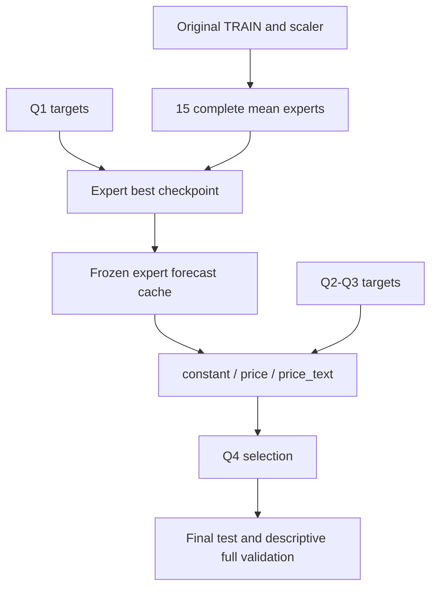

# Q1 mean experts and frozen router

Base SHA `da3cbe771cd8329943d4321a492bfa07c8ffa316` is from
`experiment/context-price-mean-lag-grid-extension`.

The explicit `--selection_protocol temporally_separated` reuses the original
runner's `_run_epoch`, Adam lr 0.001, batch 32, max 50 epochs and patience 10.
The base code has no scheduler. Its `Dataset_Custom` controls the exact
TRAIN/test policy and train-only price scaler. Original source code remains
the authority for the 2019–2021 training rows and 2023 targets.

Validation windows are assigned by all three target dates. Boundaries are
half-open. Cross-boundary windows are excluded from named assignments, counted,
and retained in descriptive full-2022 evaluation.

| Assignment | Start | End | Role |
| --- | --- | --- | --- |
| expert_selection | 2022-01-01 | 2022-04-01 | expert checkpoint and early stopping |
| router_train | 2022-04-01 | 2022-10-01 | router and its feature scaler |
| router_validation | 2022-10-01 | 2023-01-01 | router checkpoint and fixed expert choices |

Experts evaluate Q1 alone during optimization. Ties retain the earlier epoch.
The complete 2022 validation and test errors are reported after all selection.
`test_previously_inspected=true` records the historical use of 2023.

## Experts and controls

W=10/20/40/60/80 crosses gate lags [1,5], [1,5,20], [1,2,5,10,20].
Each expert contains its own full financial backbone, original MiniLM
embeddings, five separate linear heads and its price gate, with fixed alpha
0.1 and the existing blend. Mean80 uses the existing extra-history wrapper.

The matched baseline is taken from `db35a2d`, `run.py:TextModel`,
`dataset.py` and the historical baseline shell manifest. It uses one
Linear(384,3) after averaging five groups per dimension. NaNs are skipped
before filling the resulting missing mean. Its formula is
`0.9*financial + 0.1*present*(last_price + Linear(group_mean))`.
The new matched baseline receives the requested 50-epoch/Q1 protocol.
Historical errors and the old queue's training budget remain separately
identified.

The registry matches the twelve names in the historical shell loop:
Autoformer, Crossformer, DLinear, FiLM, Informer, iTransformer,
Nonstationary_Transformer, PatchTST, Reformer, TiDE, Transformer, TSMixer.
Plan supports all names. This training queue enables FiLM.

There are 450 expert fits (15×10×3), 30 baseline fits (10×3) and nine router
fits (3 modes×3 seeds), totaling 489. A router covers all ten stocks for one
backbone and seed. Fifteen NVDA expert smoke checks and one baseline smoke
check are additional. Twelve-backbone counts would be 5400+360+108.

## Router and evidence

```math
\pi_t=\operatorname{softmax}(A z_t+a),\qquad
\hat y_t=\sum_{k=1}^{15}\pi_{t,k}\hat y_{t,k}.
```

Constant has 15 trainable logits. Price is Linear(20,15); price_text is
Linear(40,15). Zero initialization gives a uniform mixture, temperature 1.
One expert-weight vector applies to all three horizons and four OHLC channels.
Experts are frozen in eval, with parameters and buffers fingerprinted before
and after caching. Router optimizers contain only router parameters.

Price features are normalized OHLC differences in lag order 1,2,5,10,20,
channel order open,high,low,close. Text features follow group order
macro,sector,targetCompany,relatedCompany,filing. Each group supplies current
presence, available fraction in the last 20 rows including t, cosine distance
to the masked mean of 20 previous rows excluding t, and cosine availability.
Presence and norm epsilon are 1e-6. Unavailable cosine distance and flag are
zero. Schema and epsilon are persisted. Feature scaling fits Q2/Q3 only.

Loss is mean ticker MSE + 0.001×mean square of logits parameters.
All training windows contribute with exact inverse ticker-count weights.
Chunks accumulate the complete equal-ticker objective before one AdamW update
per epoch. Default lr is .001, weight_decay 0, max_epochs 200, patience 20,
batch_size 128. CLI exposes all of these settings, including regularization.

For S stocks, n_s windows per stock and P logits parameters, the objective is
`J = sum_s(sum_i(MSE_i)/n_s)/S + 0.001*sum_p(theta_p^2)/P`.
Each chunk contributes its original window weights without an additional
division by chunk count. Gradients are cleared once before all chunks, the L2
gradient is added once afterward, and AdamW steps once. A numerical float64
test compares accumulated gradients to the direct full objective for unequal
stock counts, nonzero parameters and chunk sizes 1, 4, 13 and 128.



Audit saves every TRAIN and test window's aggregated input/target/date hashes,
source text/price/date hashes, parquet hash and scaler. It replays the old
loader for every W and compares available historical canonical artifacts.
Missing historical server artifacts remain unverified. Local synthetic
checks validate the mechanism, rather than the unavailable server runs.

Expert decomposition has financial, anchor and five signed group components.
The mixture weights each component by the same expert weights. Bias and
presence masks are included. Diagnostic PT files retain dates, expert weights,
entropy, group weights, masks, alpha and signed expert/mixture components.
Expert weights can select financial forecasts and do not establish causal
effects or textual group importance.

Best and last checkpoints are atomic. They store optimizer, scheduler=None,
scaler, RNG, train generator, epoch, best epoch, patience and history.
Both expert and router resumes validate the absent scheduler explicitly.
Router checkpoints also store Python, NumPy, CPU/CUDA RNG states and the
independent batch-order generator. A full-batch step is one AdamW update per
epoch. Its cumulative count is persisted in history, best/last checkpoints,
router summary.json and final summary.csv (per seed and total across seeds).
`--resume` restores last and analysis reads best. Default saves best+last.
`--save-epochs 10 25` retains optional epochs. Summary estimates their disk
cost. Completion markers verify artifact hashes, config and source evidence.

The expert manifest binds canonical paths, source SHA, evidence and selected
checkpoint hashes. Cache validation includes forecasts, targets, dates, scales,
feature schema, components, group diagnostics and source checkpoint hashes.
Existing incompatible artifacts stop their stage and are preserved.

CLI stages are plan / audit / smoke / train-experts / train-controls / cache /
train-router / analyze, plus queue. Explicit options include backbone, protocol,
router-mode, expert-manifest, output and resume. Queue runs stages in order
under one exclusive lock. CUDA training checks include tensor allocation.
Plan is read-only and produces the missing-task inventory.

Results under `context_price_mean_router_q1_v1/FiLM` separate experts,
controls, cache, router, checks and reports. Each task has train.log.
The background queue writes to logs.

Reports contain Q1 MSE, Q4 MSE, descriptive full-2022 MSE, test MSE/MAE.
Methods include all experts, best global and per-stock Q4 choices, equal
mixture, constant, price and price_text. Per-run CSV includes all stocks,
seeds and losses. Percentages use ratios of mean errors to the new matched
baseline, mean80/five-lag, best-global and per-stock fixed controls.
Historical 0.01381580/0.01532807 errors remain descriptive with partial evidence.
Paired uncertainty first averages seeds, then jointly resamples 20-row date
blocks across stocks. Intervals condition on the chosen stocks and seeds.

## PowerShell publication

```powershell
Set-Location C:\project_fin\FinTexTS\worktrees\context-price-mean-router
git diff --check
git add forecasting_task/run.py forecasting_task/data_provider/context_novelty.py forecasting_task/mean_router_protocol.py forecasting_task/mean_router.py mean_router_experiment.py run_context_price_mean_router.sh tests/test_mean_router.py MEAN_ROUTER.md README.md
git diff --cached --stat
git commit -m "Add Q1-selected mean experts and frozen router"
git push -u origin experiment/context-price-mean-router
```

## Astra

After publication, use the existing container and its variants mount.

```bash
set -euo pipefail
git -C ~/projects/FinTexTS fetch origin
WT="$HOME/projects/FinTexTS_compare/context-price-mean-router"
git -C ~/projects/FinTexTS worktree add --detach "$WT" origin/experiment/context-price-mean-router
CTR=kondyurin-fintexts-compare
CODE=/workspace/variants/context-price-mean-router
SHA=$(git -C "$WT" rev-parse HEAD)
ROOT=/auto/datasets/kondyurin/FinTexTS/runs/context_price_mean_router_q1_v1/FiLM
docker exec "$CTR" test -f "$CODE/mean_router_experiment.py"
docker exec "$CTR" python -c 'import torch; assert torch.cuda.is_available(); torch.empty(1,device="cuda"); print(torch.cuda.get_device_name(0))'
PROCESSES=$(docker top "$CTR" -eo pid,args)
if grep -E 'mean_router_experiment[.]py|forecasting_task[.]run|run_.*(queue[.]py|[.]sh)' <<< "$PROCESSES"; then
  echo 'An experiment is already running'; exit 1
fi
```

Before the 489-fit queue, run these three stages individually. Plan is read-only.
Audit checks actual server data without optimization, saves data_audit.json,
and verifies the pinned base Dataset_Custom code hash even when Git metadata
is unavailable inside the container. Smoke runs only 16 one-epoch checks
under checks/. Inspect each result before launching the full queue.

```bash
docker exec -e PYTHONPATH="$CODE:$CODE/forecasting_task" -w "$CODE" "$CTR" \
  python mean_router_experiment.py plan --backbone FiLM --output "$ROOT"

docker exec -e CODE_COMMIT="$SHA" -e PYTHONPATH="$CODE:$CODE/forecasting_task" \
  -e OMP_NUM_THREADS=2 -e MKL_NUM_THREADS=2 -w "$CODE" "$CTR" \
  python -u mean_router_experiment.py audit --backbone FiLM --output "$ROOT"

docker exec -e CODE_COMMIT="$SHA" -e PYTHONPATH="$CODE:$CODE/forecasting_task" \
  -e OMP_NUM_THREADS=2 -e MKL_NUM_THREADS=2 -w "$CODE" "$CTR" \
  python -u mean_router_experiment.py smoke --backbone FiLM --output "$ROOT"
```

After checking audit and smoke results, recheck active processes before queue startup.

```bash
LOG="$ROOT/logs/queue_$(date -u +%Y%m%dT%H%M%SZ)_$$.log"
docker exec -d -e CODE_COMMIT="$SHA" -w "$CODE" "$CTR" bash -c '
  set -euo pipefail
  mkdir -p "$(dirname "$1")"
  exec bash run_context_price_mean_router.sh >"$1" 2>&1
' _ "$LOG"
docker exec "$CTR" tail -n 60 -F "$LOG"
```

For resume, inspect active processes first and use the same code SHA/output.

```bash
docker top "$CTR" -eo pid,args
LOG="$ROOT/logs/resume_$(date -u +%Y%m%dT%H%M%SZ)_$$.log"
docker exec -d -e CODE_COMMIT="$SHA" -w "$CODE" "$CTR" bash -c '
  exec bash run_context_price_mean_router.sh --resume >"$1" 2>&1
' _ "$LOG"
docker exec "$CTR" tail -n 60 -F "$LOG"
docker exec -e PYTHONPATH="$CODE:$CODE/forecasting_task" -w "$CODE" "$CTR" python mean_router_experiment.py plan --backbone FiLM
docker exec -e CODE_COMMIT="$SHA" -w "$CODE" "$CTR" bash -c '
  export PYTHONPATH="$PWD:$PWD/forecasting_task"
  python mean_router_experiment.py analyze --report-name review2
'
```
