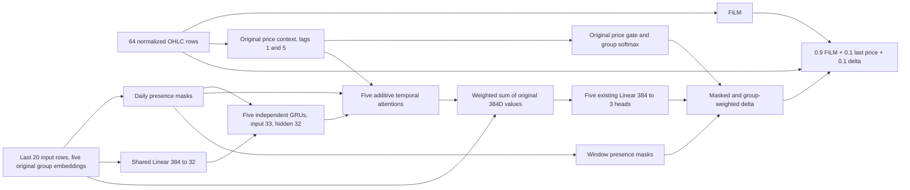
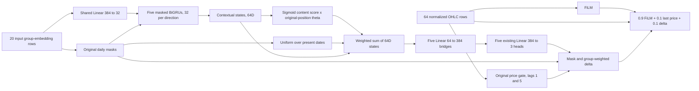

# FinTexTS

This repository contains code for forecasting with financial text and time-series data. It is organized into two parts: **data generation** and **forecasting experiments**.

## Structure

### 1) Data generation
Only a lightweight version of the data generation pipeline is included. Sample data can be created using the scripts in `make_dataset/`, for example:

- `make_dataset/company_summary.py`
- `make_dataset/filing_parser.py`
- `make_dataset/macro-sector_summary.py`
- `make_dataset/tag_company_news.py`
- `make_dataset/tag_news.py`

For access to the full dataset, refer to the following Hugging Face page:  
<https://huggingface.co/EXAONE-BI>  
[Reference link](https://huggingface.co/EXAONE-BI)

Raw news data was sourced from the FNSPID news dataset:
<https://github.com/Zdong104/FNSPID_Financial_News_Dataset>

### 2) Forecasting experiments
The entry point for forecasting experiments is `forecasting_task/run.py`. Before running it, you must generate text embeddings and create a per‑ticker parquet file.

#### (1) Text embedding generation
BERT embeddings are the default. Depending on the embedding model, columns are created as `*_emb1 ... *_embN`.

#### (2) Per‑ticker parquet creation
Create a parquet file **per ticker** with the following columns and save it to `data/fintexts/{TICKER}.parquet`.

- `date`, `ticker`, `open`, `high`, `low`, `close`
- `macro_emb1`, `macro_emb2`, ...
- `sector_emb1`, `sector_emb2`, ...
- `targetCompany_emb1`, `targetCompany_emb2`, ...
- `relatedCompany_emb1`, `relatedCompany_emb2`, ...
- `filing_emb1`, `filing_emb2`, ...

#### (3) Run example
```bash
python forecasting_task/run.py \
  --root_path data/ \
  --data_path fintexts/NVDA.parquet
```

### Independent group MLP fusion

The text branch consumes the last day's separate embeddings in this order:
`macro, sector, targetCompany, relatedCompany, filing` (`[batch, 5, 384]`).
Each group has its own MLP. `--text_num_layers 1` uses `Linear(384, pred_len)`;
larger values use `--text_hidden_size` hidden units and ReLU between linear layers.
The dataset preserves group embeddings and fits the price scaler on training dates only.

Group logits `G` start at `log(initial_weights)`, so `softmax(G)` initially assigns
the chosen group weights (uniform 0.2 per group by default). Set them with
`--initial_group_weights 0.6 0.1 0.1 0.1 0.1`, in `--used_col_prefixes` order.
The count must match the selected groups; values must be finite and strictly
positive, and their sum must equal 1 within absolute tolerance `1e-6`.
Initializing `G` consumes no random numbers and happens after head construction;
the same seed therefore gives identical initial FiLM and head parameters across
group initializations. A group is present when its original embedding has absolute sum
at least `1e-6`. Its output is masked **after** the MLP; missing groups contribute
zero without redistributing their weights. The weighted sum `delta` has one
correction per forecast horizon, shared across all four OHLC channels.

`alpha = sigmoid(alpha_logit)` is trained jointly with FiLM, the MLPs and `G`.
`--text_weight` sets its initial value (default 0.1, strictly between 0 and 1).
Choose `--fusion_mode`:

- `blend` (default): `(1-alpha) * price_output + alpha * (last_price + delta)`.
  If all groups are absent, the entire text prediction is zero, including last price.
- `residual`: `price_output + alpha * delta`. If all groups are absent, this equals
  the price forecast exactly; last price is never added in this mode.

From the repository root in PowerShell, set the existing TS modules' import path:

```powershell
$env:PYTHONPATH = "$PWD;$PWD\forecasting_task"
```

Two otherwise identical one-epoch trial commands (require the prepared parquet data):

```powershell
python -m forecasting_task.run --model_type FiLM --root_path data/ --data_path fintexts/NVDA.parquet --seq_len 64 --label_len 16 --pred_len 3 --batch_size 32 --text_num_layers 2 --text_hidden_size 64 --text_weight 0.1 --seed 7 --num_epoch 1 --patience 1 --fusion_mode blend --logdir logs/group_mlp_blend_smoke
python -m forecasting_task.run --model_type FiLM --root_path data/ --data_path fintexts/NVDA.parquet --seq_len 64 --label_len 16 --pred_len 3 --batch_size 32 --text_num_layers 2 --text_hidden_size 64 --text_weight 0.1 --seed 7 --num_epoch 1 --patience 1 --fusion_mode residual --logdir logs/group_mlp_residual_smoke
```

Use an empty/new log directory for each run. `args.yaml` and `best_checkpoint.pt`
record the fusion mode, group order, MLP structure and initial settings.
The checkpoint stores both model state dictionaries (including all group MLPs,
`G` and `alpha_logit`), optimizer state, and train scaler statistics. Reconstruct
the text branch with `TextModel(**checkpoint["args"]["text_model_config"])`, then
load `checkpoint["text_model_state_dict"]`. Reconstruct FiLM using checkpoint
arguments and load `checkpoint["model_state_dict"]`; call `eval()` on both models
for inference and use the saved scaler statistics to scale incoming prices.

Each `history.jsonl` epoch records `text_alpha` and named `group_weights`.
`summary.json` separates `best_text_alpha` / `best_group_weights` (the best
validation checkpoint) from `final_text_alpha` / `final_group_weights` (the last
completed epoch). Existing MSE/MAE, timing, chronological splits and early stopping
are preserved.

`initial_group_weights` in `args.yaml`, `summary.json` and checkpoint arguments
is an ordered list of the actual initial softmax values, captured before the
optimizer is created. `initial_group_logits` in the arguments records the actual
starting logits. `text_model_config.initial_group_weights` retains the requested
weights for reconstruction; tiny float32 rounding differences are expected.
Initial values are separate from the named best/final group weight dictionaries.

### Linear heads without learned group weights

Select `--group_weight_mode fixed_uniform --text_num_layers 1` for the new
variant. The existing `learnable` mode remains available for previous experiments.
The fixed variant requires all five groups in the order
`macro, sector, targetCompany, relatedCompany, filing`. Each head is independently
initialized as `Linear(384, pred_len)`, with no hidden layer or activation.
`text_hidden_size` does not affect these heads. The fixed model has no `G`
parameter or group softmax, including in its optimizer and checkpoint.

Using only the last day of the text window, it computes:

```text
mask[g] = abs(embedding[g]).sum(-1) >= 1e-6
delta = sum(mask[g] * head[g](embedding[g])) / 5
alpha = sigmoid(alpha_logit)
```

The mask applies after each head, including its bias. Missing groups contribute
zero; the denominator always remains five. Each horizon correction is shared
by all four OHLC channels. Fusion is unchanged:

- `blend`: `text_prediction = last_price + delta`, with the entire text prediction
  set to zero when all groups are absent;
  `output = (1-alpha)*price_output + alpha*text_prediction`.
- `residual`: `output = price_output + alpha*delta`, exactly equal to the price
  forecast when all groups are absent. Last price is not added.

`--text_weight` initializes alpha and must be strictly between zero and one.
Setting alpha and choosing the fusion mode consume no random numbers, so a given
seed produces identical initial FiLM and head parameters for alpha starts
0.01, 0.1 and 0.9 in both modes. FiLM, the heads and alpha train jointly with
the existing Adam, validation checkpoint selection and early stopping. Scaling,
chronological splits, metrics and timing remain unchanged.

`--initial_group_weights` may be omitted or set to five uniform values; nonuniform
values are explicitly rejected in this mode. Logs record
`group_weight_mode: fixed_uniform` and `fixed_group_coefficients` (0.2 per group),
without labeling these constants as learned best/final weights. Arguments,
summary and checkpoint arguments retain the actual `initial_text_alpha`;
`best_text_alpha` and `final_text_alpha` in the summary refer to the selected
validation checkpoint and last epoch respectively. Epoch history records alpha.

For restoration, call
`build_text_model(checkpoint["args"]["text_model_config"], checkpoint["args"]["group_weight_mode"])`
from `forecasting_task.models.GroupText`, then load `text_model_state_dict`.
The FiLM parameters, Adam state and train scaler statistics are also saved.
Older checkpoints without a mode use `learnable`.

A checkpoint from the old one-layer model can be migrated while preserving
predictions: for each group with old `w = softmax(G)[g]`, copy
`W_new[g] = 5*w*W_old[g]`, `b_new[g] = 5*w*b_old[g]` and the same alpha logit.
Drop `G` from the new state dictionary. This preserves the forward calculation
with masking; it does not assert identical training trajectories from scratch.

### Server experiment: 720 runs without learned group weights

Run `bash run_group_no_weights_720.sh` in the existing CUDA-enabled Docker.
The fixed-uniform server experiment uses
`/auto/datasets/kondyurin/FinTexTS/minilm_reproduction_v1/fintexts` for data and
`/auto/datasets/kondyurin/FinTexTS/runs/group_no_weights_alpha_v1` for results.
Its settings are FiLM, sequence length 64, label length 16, prediction length 3,
batch size 32, `text_num_layers=1`, learning rate 0.001, at most 50 epochs and
early stopping patience 10. Alpha labels and initial values are:

| Label | Initial alpha | Tickers | Seeds | Fusion modes | Runs |
| --- | --- | --- | --- | --- | --- |
| alpha010 | 0.1 | All 100 | 7, 17, 27 | blend, residual | 600 |
| alpha001 | 0.01 | First 10 alphabetically | 7, 17, 27 | blend, residual | 60 |
| alpha090 | 0.9 | Same first 10 | 7, 17, 27 | blend, residual | 60 |

These are exactly **720 unique configurations** with no additional seeds,
tickers or repetitions. All three alpha starts are compared on the same first
ten tickers with identical seeds and fusion modes. Sorting uses `LC_ALL=C`.

Each run's output directory follows
`RESULTS/full/{alpha_label}/{fusion_mode}/{ticker}/seed{seed}/output`, with
`train.log` beside `output`. This layout keeps alpha starts and fusion modes
separate while preserving each run's args, history, summary and best checkpoint.

The script resolves CODE from its own location, sets `PYTHONPATH` to CODE and
CODE/forecasting_task, and exports `OMP_NUM_THREADS=2` and `MKL_NUM_THREADS=2`.
It checks for exactly 100 parquet files and working CUDA before starting training.
It saves the selected ten tickers to `RESULTS/selected_tickers.txt`, the code SHA
to `code_commit.txt`, and a copy of the running script. When Git metadata is not
available inside the container, provide the full SHA without changing Git rights
or configuration:

```bash
CODE_COMMIT=<full-commit-sha> bash run_group_no_weights_720.sh
```

An existing run directory stops the queue without overwriting its contents.
An existing experiment metadata file must match. A failed training process or
missing/empty `summary.json` or `best_checkpoint.pt` stops the queue and prints
the last 30 lines of that run's `train.log`. START and OK report
`completed=N/720`; completion is printed only as `ALL 720 RUNS COMPLETED`.

### Server experiment: 720 runs with linear heads

Run `bash run_group_linear_init_720.sh` inside the existing CUDA-enabled Docker
container. The script resolves the code directory from its own location and sets
`PYTHONPATH` to include that directory and `forecasting_task`. No new dependencies
are installed. Data and output directories are fixed in the script:

```text
DATA=/auto/datasets/kondyurin/FinTexTS/minilm_reproduction_v1/fintexts
RESULTS=/auto/datasets/kondyurin/FinTexTS/runs/group_linear_init_720_v1
```

Every model uses five independent `Linear(384, 3)` heads with no hidden layer.
`text_hidden_size=64` is recorded but unused with `text_num_layers=1`.
All configurations use FiLM, sequence length 64, label length 16, horizon 3,
batch size 32, initial alpha 0.1, learning rate 0.001, up to 50 epochs and
early stopping patience 10. Both OMP and MKL thread counts are set to 2.

| Initialization | Weights: macro, sector, targetCompany, relatedCompany, filing | Tickers | Seeds | Fusion modes | Runs |
| --- | --- | --- | --- | --- | --- |
| uniform | 0.2 0.2 0.2 0.2 0.2 | All 100 | 7, 17, 27 | blend, residual | 600 |
| macro | 0.6 0.1 0.1 0.1 0.1 | First 10 alphabetically | 7, 17, 27 | blend, residual | 60 |
| targetCompany | 0.1 0.1 0.6 0.1 0.1 | Same first 10 | 7, 17, 27 | blend, residual | 60 |

The script checks for exactly 100 parquet files and working CUDA before the
queue. Sorting uses `LC_ALL=C`; the ten selected tickers are recorded in
`RESULTS/selected_tickers.txt`. It also saves `code_commit.txt` and an exact copy
of the script. If Git metadata cannot be read inside the container, pass the full
code commit SHA through the environment, for example:

```bash
CODE_COMMIT=<full-commit-sha> bash run_group_linear_init_720.sh
```

Each run writes `train.log` beside its `output` directory under
`RESULTS/full/{initialization}/{fusion_mode}/{ticker}/seed{seed}/`.
Existing run directories are never overwritten; encountering one stops the queue.
Existing experiment metadata must match and is preserved. A failed training
process, or a missing/empty `summary.json` or `best_checkpoint.pt`, stops the queue
and prints the last 30 training log lines. START/OK messages report
`completed=N/720`; only a fully successful queue prints `ALL 720 RUNS COMPLETED`.

### Validation price-anchor diagnostic

Inside the existing Docker, run the independent diagnostic (CPU by default):

```bash
python /workspace/FinTexTS/analyze_blend_price_anchor.py --device cpu
```

The default results/data roots are the same as the fixed-uniform alpha experiment.
`--results_root` and `--data_root` can relocate those inputs. The script first
requires exactly 30 distinct best checkpoints under
`full/alpha090/blend/{ticker}/seed{7,17,27}/output`, with the same ten tickers for
all seeds. It checks the selected ticker list when present. It loads configuration
and trained alpha from each best checkpoint, uses `Dataset_Custom(flag="val")`,
and compares the dataset's train-fitted mean/scale/variance to the saved scaler.
It does not call runner entry points or read saved prediction files.

For the same validation batch it evaluates the trained `full` forward,
`no_text_delta = (1-alpha)*film_output + alpha*last_price`, and persistence
(`last_price` expanded across the horizon). The no-text-delta baseline retains
last price even for absent text. All models run in eval under no-grad; MSE/MAE
are accumulated over all normalized OHLC elements, including the last partial
batch. No inverse transform is applied. Full MSE must reproduce the summary's
`best_val_mse` with `rtol=1e-4, atol=1e-6`; a mismatch stops with the checkpoint
path and both MSE values. No test-split evaluation or training is performed.

After all 30 runs pass, CSVs are written only to
`group_no_weights_alpha_v1/diagnostics/price_anchor/`:

- `runs.csv`: per-run trained alpha, element count, all six errors and comparisons.
- `by_seed.csv`: arithmetic means across ten tickers, percentage changes and win counts.
- `across_seeds.csv`: means and sample standard deviations across three seed means
  (`ddof=1`).
- `comparisons.csv`: overall strict win counts out of 30 and percentage MSE changes
  computed from the overall mean errors.

Percentage change is `100*(full-reference)/reference`; negative values mean full
has lower MSE. A zero reference MSE gives an undefined percentage (blank CSV cell).
Existing diagnostic CSVs are preserved; move a previous report before rerunning.
Original training outputs are never overwritten.

### Persistence comparison across 100 tickers

Inside the existing Docker, run:

```bash
python /workspace/FinTexTS/analyze_persistence_baseline.py --device cpu
```

The script uses the prepared parquet data and the six `full/alpha010` runs per
ticker (blend/residual, seeds 7/17/27) under `group_no_weights_alpha_v1`.
The historical comparison comes from
`film_compare_50ep_v1/full/baseline/{ticker}/seed{seed}/output`.
`--results_root`, `--baseline_root` and `--data_root` can relocate these inputs.
No forecasting models or runner entry points are imported; model errors are
read from summaries, preferring the available `best_val_mse`, `best_test_mse`,
`best_test_mae` and `best_val_mae` fields (or explicitly named split-specific
fields if best fields are absent). Missing metrics remain blank, and each
reported model error records its actual source key.

Exactly 100 distinct ticker parquet files and all 600 primary run configurations
are required. Sequence/prediction/label lengths, four price channels, saved
scalers, dataset preprocessing and declared split parameters are checked before
pooling runs. The current `Dataset_Custom` fixed date policy is recorded explicitly:
data from 2019-01-01 to 2023-12-19 exclusive, training before 2022-01-01,
validation during 2022, and test during 2023 (with the data cutoff applied).
Unknown saved split overrides are rejected rather than silently ignored.

Persistence uses only `seq_price_x[:, -1:, :]`, expanded across `pred_len`;
targets are the last `pred_len` entries of `seq_price_y`. Both val and test are
replayed with `Dataset_Custom`, no shuffling, no dropped final batch, and no
inverse transform. Error sums use all normalized OHLC elements. One val/test
calculation per ticker is reused after the six configurations/scalers match,
and seed/fusion independence of the resulting persistence scores is checked.
No data-loader, forecasting model or training code is modified.

For every primary run, normalized `inputs` and `ground_truths` from `test_io.pt`
are checked against the complete ordered replayed test windows and targets.
Saved-window persistence must agree too. Arrays ending in `_inv` are not used.
Missing normalized arrays are reported with the file's actual keys; primary test
improvements are withheld if saved-window verification is unavailable, and an
actual primary window mismatch stops analysis. Historical baseline comparisons
require matching configuration/scaler/split policy; saved windows are additionally
checked when available. Missing historical saved windows are explicitly labeled,
while configuration/scaler/window mismatches suppress relative improvements.
Available raw historical summary errors remain visible with comparison status.

Reports are written only after successful primary checks, to
`group_no_weights_alpha_v1/diagnostics/persistence_100/`:

- `per_run.csv`: persistence, both new variants and historical baseline, each
  ticker/seed; raw errors, comparability, actual metric keys and test-file checks.
- `per_ticker.csv`: three-seed means, confirmed improvements and stock-level wins.
- `by_seed.csv`: means across all 100 stocks for each seed, with metric availability
  and comparability counts. An incomplete cohort is never substituted for 100 stocks.
- `across_seeds.csv`: mean and sample std (`ddof=1`) between three seed means.
- `wins.csv`: stocks whose three-seed mean test MSE is strictly below persistence,
  with the confirmed denominator and an explicit `all_100_confirmed` indicator.
- `issues.csv`: missing fields/files and reasons for exclusion.
- `configurations.csv`: replay settings, fixed split policy, scaler statistics,
  element counts and hashes of the normalized val/test windows and targets.

`improvement_pct = 100*(persistence_error-model_error)/persistence_error`;
positive means the model is better. Zero-denominator percentages are blank.
Overall improvements require all 100 comparable stocks for each seed. Missing
validation MAE is never filled using test MAE. Original training artifacts and
existing diagnostic CSVs are preserved.

Run synthetic checks without a dataset or GPU:

```powershell
python -m unittest discover -s tests -v
```

These checks cover batch sizes 1 and greater, one/two/deeper MLPs, missing text,
both fusion formulas, gradients and optimizer membership, train-only scaling,
best/final logging, early stopping and exact eval prediction recovery from disk.
They also check weight validation, the three starting distributions, single-layer
head structure and independence of FiLM/head initialization from group weights.
When Bash is available, the suite checks shell syntax and dispatches all 720
configurations of each dispatcher using fake training/CUDA, plus failure and
overwrite guards. Fixed-uniform tests additionally cover the absence of G,
all alpha starts, initialization independence across fusion modes, old checkpoint
migration and exact prediction recovery from disk.

### Context and novelty gate: 60 runs

`--group_gate static|context_novelty` opts into a separate anchored FiLM experiment.
The existing fusion modes retain their behavior. Both conditions use five
independent `Linear(384, pred_len)` heads in order macro, sector, targetCompany,
relatedCompany, filing, and **constant alpha=0.1** (a buffer, no alpha logit or G):

```text
d_g = Linear_g(last_input_day_embedding_g)
mask_g = abs(embedding_g).sum(-1) >= 1e-6
delta = sum_g(w_g * mask_g * d_g)
prediction = 0.9 * FiLM_output + 0.1 * (last_price + delta)
```

The mask applies after each head, including its bias. The correction at each
horizon is shared across the four normalized OHLC channels. Last price is the
last known normalized input OHLC vector, repeated across the prediction horizon;
it remains in the formula with completely missing text. Weights are never
renormalized over present groups.

`static` uses w=0.2 for every group. `context_novelty` forms 18 features:

```text
context = concat(X[-1] - X[-2], X[-1] - X[-6])  # 8 input OHLC features
novelty_g = 1 - cosine(e_current_g, e_previous_present_g)
features = concat(context, novelty_5, pair_available_5)
weights = softmax(Linear(18, 5)(features), dim=-1)
```

The gate has exactly 95 parameters. Weight matrix and bias start at zero, giving
identical initial weights (0.2) and predictions to static. Gate construction
preserves the RNG state; each seed has identical initial FiLM/head parameters
and a separate seeded train-loader generator ensures identical batch permutations.
FiLM, heads and the dynamic gate train jointly with Adam, without new dropout or
regularization. The optimizer includes each trainable parameter once.

`data_provider/context_novelty.py` wraps `Dataset_Custom` only for this experiment.
The base dataset, scaler and split implementation are unchanged. It computes
novelty in chronological row order for one ticker at a time, using the previous
strictly earlier **present** embedding of the same group, including available
history before the current input window and across split boundaries. The current
row is evaluated before updating its history; missing rows do not erase earlier
text. If either embedding is unavailable, novelty and pair_available are zero.
Cosine uses finite float64 normalized vectors, excludes zero norms and clips to
[-1,1]. Embeddings and parquet files are not modified. Features are indexed by
the actual last input row and do not depend on batching or shuffling.

The wrapper verifies one ticker per file, unique chronological dates, and exact
agreement with the base dataset's text/price slices. seq_len must be at least six.
The existing daily row convention is preserved: these data do not identify the
timing of intraday market reactions. Weights are allocation coefficients, not
causal importance or a fraction of news already reflected in prices.

After training, the best validation-MSE checkpoint is restored and validation
runs in eval/no_grad. Its MSE is checked against the selected best value.
`validation_group_diagnostics.csv` has five rows per window, in dataset window
order followed by group order, with:

- window index and actual date of the last input observation;
- group, presence, novelty, pair_available and weight;
- raw head outputs `head_h1..h3`;
- actual normalized prediction corrections `contribution_h1..h3`, equal to
  `0.1 * weight * mask * head` and shared across OHLC channels.

`validation_weights.png` plots weights over time, and
`validation_contributions_h1.png` through `h3.png` plot contributions separately
for each horizon. This diagnostic uses validation only; test metrics never select
the checkpoint. The normal args/history/summary/checkpoint/test_io artifacts and
train/val/test timings remain, with separate `diagnostic_seconds` and total time
including diagnostics. Configurations record fixed alpha, gate structure, novelty
policy, group order and code SHA. Checkpoints include both model states, optimizer,
train-only scaler statistics and train-generator state. Reconstruct text fusion
with `build_text_model(checkpoint['args']['text_model_config'],
checkpoint['group_weight_mode'])`, then load `text_model_state_dict`.

Inside the existing server Docker, from the code checkout:

```bash
bash -n run_context_novelty_gate_60.sh
bash run_context_novelty_gate_60.sh
```

If `.git` is unavailable, set `CODE_COMMIT` to the full deployed code SHA before
running. The dispatcher resolves CODE from its own path, sets PYTHONPATH to include
CODE and CODE/forecasting_task, and uses OMP/MKL threads=2. It checks CUDA and all
eleven required parquet files in
`/auto/datasets/kondyurin/FinTexTS/minilm_reproduction_v1/fintexts`.

It first runs NVDA seed=7 for one epoch per condition in `checks/`; these two
runs are separate from the 60 main runs: AAPL, ABBV, ABT, ACN, ADBE, ADI, AMAT,
AMD, AMGN, AMZN × seeds 7/17/27 × static/context_novelty. Main settings are FiLM,
seq_len=64, label_len=16, pred_len=3, batch_size=32, text_num_layers=1,
text_hidden_size=64 (unused), num_epoch=50, patience=10, lr=0.001, alpha=0.1.

Results root is `/auto/datasets/kondyurin/FinTexTS/runs/context_novelty_gate_v1`:

```text
code_commit.txt
selected_tickers.txt
run_context_novelty_gate_60.sh
checks/{condition}/NVDA/seed7/{train.log,output/}
full/{condition}/{ticker}/seed{7,17,27}/{train.log,output/}
```

Existing destinations are rejected before training. Errors stop the queue and
print the log tail; OK requires nonempty summary.json and best_checkpoint.pt.
Progress counts only the main runs, ending in `ALL 60 RUNS COMPLETED`.

`tests/test_context_novelty*.py` covers the formulas, masks, exact zero-gate/static
start, gradients, fixed alpha, initialization and batch permutations, first text,
gaps, cross-split history, future independence, batch independence, base-scaler
agreement, checkpoint/diagnostic reconstruction, and a mocked 2+60 queue with
failure/overwrite checks and Bash syntax validation. No server data or GPU is
needed for these checks.

### Novelty ablation across all 100 tickers

`--group_gate context_no_novelty` adds an ablation of the dynamic gate. Existing
`static` and `context_novelty` behavior is preserved. Both dynamic conditions use
the same zero-initialized `Linear(18,5)` gate (95 parameters):

```text
context_novelty:    concat(price_context_8, novelty_5, pair_available_5)
context_no_novelty: concat(price_context_8, zeros_5,   pair_available_5)
delta = sum_g(weight_g * present_g * head_g(embedding_g))
prediction = 0.9 * FiLM_prediction + 0.1 * (last_price + delta)
```

Only gate input columns 8..12 are zeroed. The original embeddings, five linear
heads, presence masks, price context and pair_available are unchanged. Causal
novelty is still calculated from the same history for both conditions. Validation
CSV diagnostics retain the real `novelty` and add `novelty_used`: real novelty for
context_novelty, zero for context_no_novelty. Existing CSV/plot filenames, window
ordering and best-checkpoint export are retained. The chosen condition is saved
in args, history, summary, checkpoint and text_model_config, so the existing
`build_text_model` reconstruction procedure restores the correct ablation.

Both conditions train FiLM, heads and gate from scratch. Alpha stays fixed at 0.1;
scaling, splits, metrics, early stopping and validation-MSE selection are unchanged.
For one seed both conditions have identical FiLM/head initialization, initial
predictions and train batch permutations. Seeds are used directly, without a
condition-dependent offset.

Inside the existing Docker, from the code checkout:

```bash
bash -n run_context_novelty_100.sh
bash run_context_novelty_100.sh
```

Supply the full deployed code SHA through `CODE_COMMIT` if `.git` is unavailable.
The dispatcher reads exactly 100 parquet files, sorted by filename with LC_ALL=C,
checks ticker uniqueness (also rejecting case-only duplicates), and records all
100 tickers in selected_tickers.txt. Data remain under
`/auto/datasets/kondyurin/FinTexTS/minilm_reproduction_v1/fintexts`.

Two NVDA seed=7 one-epoch checks run first, followed by **600 new main runs**:
100 tickers × seeds 7/17/27 × context_novelty/context_no_novelty. Main settings are
FiLM, seq_len=64, label_len=16, pred_len=3, batch_size=32, num_epoch=50, patience=10,
Adam lr=0.001, all five groups, text_num_layers=1 and fixed alpha=0.1.
Results use the new root
`/auto/datasets/kondyurin/FinTexTS/runs/context_novelty_100_v1`:

```text
checks/{condition}/NVDA/seed7/{train.log,output/}
full/{condition}/{ticker}/seed{7,17,27}/{train.log,output/}
```

The previous 10-ticker results are neither reused nor moved. The dispatcher
preserves CUDA preflight, CODE/PYTHONPATH resolution, OMP/MKL threads=2, SHA and
script-copy recording, destination overwrite guards, log tails on failure, and
nonempty summary/checkpoint checks. START/OK progress excludes the two checks and
ends at N/600 with `ALL 600 RUNS COMPLETED`.

Synthetic checks verify that only novelty inputs are ablated, those five gate
weight columns receive exactly zero gradients in the ablation and can receive
nonzero gradients with novelty, initial states/predictions and batch order match,
both checkpoints and diagnostics restore correctly, and the mocked dispatcher
contains exactly 600 unique combinations plus two checks in the prescribed order.

### Price-context-only gate: isolated pair-availability ablation

`--group_gate context_price_only` keeps `Linear(18,5)` and its zero initialization,
but passes `concat(price_context_8, zeros_like(novelty), zeros_like(pair_available))`
to the gate. Relative to context_no_novelty, only the five pair-availability inputs
are removed. The embeddings, independent linear heads and mask after each head
retain their behavior. Alpha is fixed at 0.1 and fusion remains anchored blend.
Initial FiLM/head parameters, initial forecasts and train batch order match the
other conditions at the same seed.

Validation diagnostics keep real `novelty` and `pair_available` alongside
`novelty_used` and the new `pair_available_used`. Both used fields are zero in
context_price_only. Existing conditions retain their actual gate inputs. The CSV
and plots are exported from the best validation checkpoint; saved configuration
selects the condition during reconstruction.

Inside the existing Docker, from the code checkout:

```bash
bash -n run_context_price_only_30.sh
bash run_context_price_only_30.sh
```

The dispatcher first runs a separate NVDA seed=7 one-epoch check. It then trains
30 new runs for AAPL, ABBV, ABT, ACN, ADBE, ADI, AMAT, AMD, AMGN, AMZN × seeds
7/17/27. Settings remain FiLM, seq_len=64, label_len=16, pred_len=3, batch_size=32,
five Linear(384,3) heads, alpha=0.1, Adam lr=0.001, max epochs=50, patience=10.
The train-only scaler, temporal splits, missing-text handling and metrics are
unchanged. CUDA preflight, log tails, artifact checks, overwrite guards, SHA/script
recording and CODE_COMMIT fallback are preserved. Results are separate:

```text
/auto/datasets/kondyurin/FinTexTS/runs/context_price_only_10_v1/
  checks/context_price_only/NVDA/seed7/{train.log,output/}
  full/context_price_only/{ticker}/seed{7,17,27}/{train.log,output/}
```

After the server runs finish, compare their saved metrics on CPU:

```bash
python analyze_context_price_only.py
```

The script reads the same ten tickers and three seeds from the new runs,
`context_novelty_100_v1/full/context_no_novelty/`, and
`film_compare_50ep_v1/full/baseline/`. No inference model or training entry point
is loaded. It checks saved FiLM/window/training settings, ticker/seed identity,
checkpoint selection epoch, split policy and saved OHLC scaler agreement. The
two controlled variants must also match novelty/sampling policies and head/gate
structures. A primary mismatch stops analysis; an unavailable or incompatible
historical baseline is labeled with a reason and excluded from paired comparisons
and selection. Available raw baseline errors remain visible. This is a saved
configuration/scaler comparison; it does not replay parquet data or verify saved
test windows. Missing metrics are never replaced by another split's errors.

`--results_root`, `--reference_root`, `--baseline_root`, and `--output_dir` can
relocate inputs/reports. Reports default to the new results root's
`diagnostics/comparison_10/`, and an existing report directory is rejected:

- `per_run.csv`: validation MSE, test MSE/MAE, actual source fields and comparability.
- `per_ticker.csv`: each stock's three-seed averages.
- `by_seed.csv`: each seed's arithmetic means over all ten stocks.
- `across_seeds.csv`: mean and sample std (ddof=1) between the three seed means.
- `paired_by_ticker.csv`: paired differences after averaging seeds; left minus
  right, negative means the left variant has lower error.
- `wins.csv`: strict wins and ties for each pair/metric after averaging seeds,
  with the confirmed denominator out of ten.
- `issues.csv`: missing metrics and baseline comparability failures.
- `selection.json`: variant(s) minimizing mean validation MSE; test errors never
  participate in selection. Averages require complete cohorts rather than subsets.

Seed/statistics tables, paired stock differences, win counts and selection are
also printed. Tests cover pair-availability invariance with a nonzero gate,
presence masking, zero gradients in the ten unused columns, matched initialization
and batching, checkpoint/diagnostic restoration, a mocked 1+30 queue, statistical
aggregation, mismatch exclusions, read-only analysis and validation-only selection.

## Group-GRU temporal attention with a matched last control

Branch `experiment/context-price-group-gru-attention` starts from
`experiment/context-price-only`. The original implementation uses five
independent `Linear(384,3)` heads, the last group embedding, and a zero-initialized
`Linear(18,5)` price gate. Its eight price features are lag-1 and lag-5 differences
of normalized OHLC, followed by ten zero entries. The original queue sets
FiLM, seq_len=64, label_len=16, pred_len=3, batch_size=32, Adam lr=0.001,
max_epochs=50, patience=10 and fixed alpha=0.1.

`--text_temporal_pool last` retains that forward and is the default.
`--text_temporal_pool group_gru_attention` requires `context_price_only` and an
input window of at least 20 rows. It selects exactly the last 20 input rows,
including the input end date. These are dataset rows. The first available text
in this slice has gap zero, and later gaps count rows from the preceding
available text in this same slice. Presence is evaluated with float32 L1 >= 1e-6
before projection. Each missing row preserves the preceding GRU state and has
zero attention weight.

For each group g in macro, sector, targetCompany, relatedCompany, filing:

```text
c_t = concat(X[-1] - X[-2], X[-1] - X[-6])                 # OHLC order
w = softmax(price_gate(concat(c_t, zeros(5), zeros(5))))
q[g,i] = concat(shared_Linear_384_to_32(e[g,i]), gap[g,i]/20)
h[g,i] = GRU_g(q[g,i], preceding_state)                   # present rows
age[i] = (t-i)/19
score[g,i] = v_g^T tanh(A_g h[g,i] + B_g c_t + D_g age[i] + b_g)
beta[g,:] = masked_softmax_over_present_dates(score[g,:])
pooled[g] = sum_i beta[g,i] * original_embedding[g,i]
present_window[g] = any_i present[g,i]
delta[h] = sum_g w[g] * present_window[g] * head_g(pooled[g])[h]
prediction[h,:] = 0.9*FiLM[h,:] + 0.1*last_price[:] + 0.1*delta[h]
```

The shared projection is `Linear(384,32)` with bias. Each group has its own
one-layer, unidirectional `GRU(input_size=33, hidden_size=32)` and its own
32-dimensional additive attention. Attention keys use the GRU states, original
8-dimensional price context and scalar age. Values retain the original 384D
embeddings and their norms. Beta is shared across forecast horizons. The existing
five heads receive the pooled values. A sole available date has beta=1. Empty
groups have zero aggregate, beta and contribution after the head, including its
bias. Group presence follows the original daily masks even if pooled vectors
cancel. A group can contribute through earlier texts when the current row is empty.

The new projection/GRUs/attention use PyTorch default initialization with zero
additive attention bias, inside an isolated RNG scope after the original heads
and price gate have been created. Common FiLM/head/gate parameters and train
batch order match across conditions at the same seed. Initial predictions may
differ because the heads receive different embeddings. The projection, all GRUs,
attention, existing heads, gate and FiLM are optimized jointly by the existing Adam.



Args, history, checkpoint and summary identify the temporal mode. Args,
checkpoint and summary include the layer structure, full code SHA, explicit split
policy and fingerprints of normalized price inputs, future targets, input-end
dates and target dates for both validation and test. Checkpoints also retain the
train-only scaler, optimizer and every trainable parameter. These shared-window
fingerprints must match in the two conditions. Their text slices are explicitly
recorded as one row for last and 20 rows for Group-GRU.

Validation diagnostics restore the checkpoint selected by lowest validation MSE.
`validation_group_diagnostics.csv` retains the group weights and signed group
contributions and adds the 20 dates, daily masks and beta for Group-GRU.
`validation_text_dates.csv` contains each window/group/date, scaled age and gap,
mask, beta, price group weight and signed date/group contributions for h=1,2,3.
`validation_prediction_components.csv` records FiLM, anchor and total text
components for each horizon and OHLC channel. Runtime checks verify both sums:

```text
C[g,i,h] = alpha*w[g]*beta[g,i]*(W[g,h] @ e[g,i] + b[g,h])
sum_i C[g,i,h] = group_contribution[g,h]
prediction[h,:] = (1-alpha)*FiLM[h,:] + alpha*last_price[:] + sum_gi C[g,i,h]
```

These are decompositions of the model output at its computed weights. Removing
one date changes GRU states and attention and requires a new forward pass.
The recorded contribution therefore does not identify the effect of deletion or
establish that a news item caused a price movement.

`run_context_price_group_gru_attention_60.sh` first runs separate one-epoch
NVDA seed7 checks for last and group_gru_attention, followed by exactly 60 full
runs, both modes ? AAPL ABBV ABT ACN ADBE ADI AMAT AMD AMGN AMZN ? seeds 7/17/27.
Both conditions start from scratch in this branch. The dispatcher uses the old
price-only queue's settings, CUDA preflight, OMP/MKL threads=2, full SHA with
CODE_COMMIT fallback, script copy, overwrite guards, log tails and nonempty
summary/checkpoint checks. It reports completed=N/60 and ALL 60 RUNS COMPLETED.

```text
/auto/datasets/kondyurin/FinTexTS/runs/context_price_group_gru_attention_10_v1/
  checks/{last,group_gru_attention}/NVDA/seed7/{train.log,output/}
  full/{last,group_gru_attention}/{ticker}/seed{7,17,27}/{train.log,output/}
```

`analyze_context_price_group_gru_attention.py` reads saved configurations and
metrics on CPU. The main comparison requires 30 unique ticker/seed checkpoints
per condition, matching settings, code SHA, train-only scaler, split policy,
full persisted validation/test window fingerprints, and saved normalized test
inputs and targets. A mismatch blocks selection and the program exits with an
error after writing its report. The original FiLM-with-text baseline is read
from `film_compare_50ep_v1/full/baseline`. Its saved args and artifacts determine
comparability. Historical missing fields are listed under `partial`; detected
mismatches suppress relative gains and the 0.8 baseline target for that comparison.
Published launcher text is not used to infer historical run settings.

Reports are created exclusively under `diagnostics/comparison/`, preserving prior
reports and training artifacts. They include per-run and per-ticker validation
MSE/test MSE/MAE, seed means, mean and sample std between the three seed means,
paired differences, wins after averaging seeds, test MSE reduction and
`0.8 * baseline_test_mse` on the complete comparable cohort. Baseline comparisons
with partial evidence are labelled as such. The selected model uses only overall
validation MSE from the new matched pair.

When aligned normalized test outputs and targets are available, the analyzer
also reports strong-movement errors. For each ticker/horizon it derives the 90th
percentile of `abs(Close[t+h]/Close[t] - 1)` using complete train windows in the
original price scale, then applies that fixed threshold to test. CSVs record the
threshold, train/selected/total window counts, normalized OHLC MSE and the selected
windows' share of matched-last squared error at that horizon. Seed tables pool
SSE over all selected OHLC elements and keep horizons separate. These diagnostics
are excluded from model selection. Aggregate MSE and beta do not establish anomalies.

After this branch is committed and published, execute the following on astra
from the existing host Git checkout. The dedicated detached worktree is copied
to a fresh code directory in the existing container, and CODE_COMMIT records the
host commit even when the worktree's Git metadata is inaccessible inside Docker.

```bash
git fetch origin
WORKTREE=/auto/datasets/kondyurin/FinTexTS/worktrees/context-price-group-gru-attention
git worktree add --detach "$WORKTREE" origin/experiment/context-price-group-gru-attention
CODE_COMMIT=$(git -C "$WORKTREE" rev-parse HEAD)
CONTAINER_CODE=/tmp/fintexts-context-price-group-gru-attention
docker exec kondyurin-fintexts-compare test ! -e "$CONTAINER_CODE"
docker cp "$WORKTREE" "kondyurin-fintexts-compare:$CONTAINER_CODE"

docker exec kondyurin-fintexts-compare python -c \
  'import torch; assert torch.cuda.is_available(); print(torch.cuda.get_device_name(0))'

docker exec -e CODE_COMMIT="$CODE_COMMIT" -w "$CONTAINER_CODE" \
  kondyurin-fintexts-compare bash run_context_price_group_gru_attention_60.sh

docker exec -w "$CONTAINER_CODE" kondyurin-fintexts-compare \
  python analyze_context_price_group_gru_attention.py
```

Both the worktree and container-code destination must be fresh. The dataset and
results use the existing `/auto/datasets` volume. The sequence above runs in the
foreground and streams START/OK/progress and the final report. Synthetic CPU
checks exercise GRU masking, gaps, group/batch isolation, causal window alignment,
common initialization/batch order, checkpoint and contribution reconstruction,
train-only return thresholds, comparison failures and the mocked 2+60 dispatcher.

## Adapted HAN temporal block

Branch `experiment/context-price-han-temporal` starts from the committed
`experiment/context-price-group-gru-attention`. The original source checked is
Hu et al., *Listening to Chaotic Whispers*, WSDM 2018, arXiv:1712.02136v3,
section 4.2, **Sequential Modeling** and **Temporal Attention**. The paper encodes
the daily sequence with BiGRU, concatenates directional states and applies:

\[
h_i=[\overrightarrow h_i;\overleftarrow h_i],\quad
 o_i=\operatorname{sigmoid}(W_hh_i+b_h),\quad
 \beta_i=\frac{\exp(\theta_i o_i)}{\sum_j\exp(\theta_j o_j)},\quad
 V=\sum_i\beta_i h_i.
\]

Here theta is position dependent. This experiment transfers that temporal
scheme into FinTexTS OHLC regression. [Original paper, section 4.2](https://arxiv.org/html/1712.02136#S4.SS2).

`--text_temporal_pool` now accepts `group_han_temporal` and `group_han_uniform`.
The existing last and group_gru_attention modes retain their forwards. Both HAN
modes use the last 20 input dataset rows ending at t, original float32 presence
masks before projection, a shared Linear(384,32), and five separate one-layer
BiGRUs with hidden_size=32 per direction. Present rows are compacted for recurrence,
then their 64D states are restored to original positions. Both directions skip
missing rows. The backward direction reads only observations within the input
window ending at t.

Our explicit scalar-score specialization and the uniform ablation are:

\[
p_{gi}=Pe_{gi}+p_0,\qquad h_{gi}=\operatorname{BiGRU}_g(p_{g,\mathrm{present}})_i\in\mathbb R^{64},
\]
\[
o_{gi}=\operatorname{sigmoid}(a_g^Th_{gi}+d_g)\in\mathbb R,\qquad
s_{gi}=\theta_{gi}o_{gi},\qquad
\beta_{gi}=\operatorname{softmax}_{i:\,m_{gi}=1}(s_{gi}),
\]
\[
\beta^{\mathrm{uniform}}_{gi}=\frac{m_{gi}}{\max(1,\sum_jm_{gj})},\qquad
z_g=\sum_i\beta_{gi}h_{gi},\quad \widetilde e_g=R_gz_g+q_g.
\]

Attention uses a Linear(64,1) sigmoid transform and 20 scalar theta parameters
per group. Theta is initialized to one and indexed by the original row 0..19,
including gaps. We chose scalar o to make theta_i*o_i a scalar logit; the paper
does not specify that intermediate dimensionality. The 64-to-384 bridge is a
separate Linear with bias for each group, with identical architecture in both
modes. Uniform retains the same scorer parameters and initialization, while its
weights are determined entirely by masks. At equal parameters both modes have
identical BiGRU states. Their BiGRUs and bridges train jointly with FiLM, heads
and price gate. The implementation uses PyTorch GRU and its update-gate/bias
conventions. Additional temporal parameters are created after the common modules
inside an isolated RNG scope.

Values are contextual BiGRU states. The existing price gate still uses normalized
OHLC lag differences [1,5] and ten zero inputs. Date scores use the sigmoid and
position parameters above. Presence of any text in the window controls the group
mask after its existing Linear(384,3) head. Empty groups have zero aggregate and
contribution, including bridge/head biases. A single present row gets weight 1.
The fusion remains:

\[
\widehat Y_{h,c}=0.9 F_{h,c}+0.1 X_{t,c}
 +0.1\sum_g w_g M_g\bigl[W_{g,h}(R_g z_g+q_g)+b_{g,h}\bigr].
\]

Five groups, FiLM, Adam, scaler, splits, 64-row price inputs and the three OHLC
forecast horizons keep the preceding experiment's settings. The adapters use
ready-made daily group embeddings. Intraday article attention, self-paced
learning and direction classification are outside this transfer's scope.
This is an adapted temporal-block experiment, with the following date decomposition:

\[
C_{gih}=0.1w_g\beta_{gi}\bigl[W_{g,h}(R_g h_{gi}+q_g)+b_{g,h}\bigr].
\]

Validation diagnostics from the best checkpoint verify sum_i C_gih equals the
masked group contribution and reconstruct all OHLC predictions with the FiLM
and anchor components. CSVs retain original dates, masks, attention weights,
group weights and signed date/group contributions. The date representation is
labelled `contextual_BiGRU_state_projected_64_to_384`. These contributions describe
contextual hidden states. Removing a source date changes states in both directions
and attention, so the decomposition does not isolate a news item's effect.

### Controls and evidence

New runs save the temporal structure and code SHA, existing validation/test
window_evidence, hashes of actual group embeddings/prices/dates for all splits,
and initial FiLM/head/price-gate state hashes. Each epoch records a hash of the
actual training indices with batch boundaries; checkpoint and summary retain the
order histories. These hashes consume no random numbers. Initial state/data
proofs must agree across conditions, and actual batch orders must agree on all
shared epochs up to the earlier stopping time. Parquet file SHA is recorded too;
semantic input hashes determine whether equivalent source arrays match.
The temporal/uniform pair also requires identical code SHA and initial
BiGRU/bridge/scorer parameter hashes, saved as temporal_initialization_sha256.

`analyze_context_price_han_temporal.py` reuses saved last and Group-GRU from
`context_price_group_gru_attention_10_v1` only when configurations, source text,
common initialization, actual batch order, windows, targets, dates and scaler
are confirmed. Missing historical evidence is explicitly partial and disables
paired comparisons/selection with that control. It never fills historical proof
from current-code assumptions. Group-GRU is an additional reference because its
date weights and pooled representations both differ from this HAN transfer.

The primary temporal-vs-uniform comparison requires 30 runs per mode and full
matched evidence. Reports include per-run/ticker/seed validation MSE, test
MSE/MAE, sample std across seed means, paired differences and ticker wins.
Selection uses validation MSE, with last included only after strict verification.
Test and strong-movement diagnostics do not enter selection. When a strict last
control is available, the existing train-only 90th-percentile Close-return
threshold diagnostic is reused. A strong price movement establishes a numerical
subset for error analysis; evidence of anomalous news requires a separate study.
Existing report directories and training outputs are preserved.

### Queue and astra commands

`run_context_price_han_temporal_60.sh` launches separate one-epoch NVDA seed7 checks
for the two HAN modes, followed by exactly 60 main runs, two modes x AAPL ABBV
ABT ACN ADBE ADI AMAT AMD AMGN AMZN x seeds 7/17/27. Settings match the preceding
Group-GRU queue (seq64, label16, pred3, batch32, Adam .001, max50, patience10,
fixed alpha .1). Data, CUDA checks, thread limits, SHA/script recording,
overwrite protection, log tails and artifact checks follow the existing queue.

```text
/auto/datasets/kondyurin/FinTexTS/runs/context_price_han_temporal_10_v1/
  checks/{group_han_temporal,group_han_uniform}/NVDA/seed7/{train.log,output/}
  full/{group_han_temporal,group_han_uniform}/{ticker}/seed{seed}/{train.log,output/}
```

Once the branch is committed and published, on astra from the host Git checkout,
use the container's existing `/workspace/variants` mount. The commands obtain its
actual host source instead of assuming a host mount path.

```bash
set -euo pipefail
git fetch origin
VARIANTS_HOST=$(docker inspect -f '{{range .Mounts}}{{if eq .Destination "/workspace/variants"}}{{.Source}}{{end}}{{end}}' kondyurin-fintexts-compare)
test -n "$VARIANTS_HOST"
WORKTREE="$VARIANTS_HOST/context-price-han-temporal"
git worktree add --detach "$WORKTREE" origin/experiment/context-price-han-temporal
CODE_COMMIT=$(git -C "$WORKTREE" rev-parse HEAD)
CONTAINER_CODE=/workspace/variants/context-price-han-temporal

docker exec kondyurin-fintexts-compare python -c \
  'import torch; assert torch.cuda.is_available(); print(torch.cuda.get_device_name(0))'
docker exec -e CODE_COMMIT="$CODE_COMMIT" -w "$CONTAINER_CODE" \
  kondyurin-fintexts-compare bash run_context_price_han_temporal_60.sh
docker exec -w "$CONTAINER_CODE" kondyurin-fintexts-compare \
  python analyze_context_price_han_temporal.py
```

If saved last is partial, explicitly launch the optional matched control:

```bash
docker exec -e CODE_COMMIT="$CODE_COMMIT" -w "$CONTAINER_CODE" \
  kondyurin-fintexts-compare bash run_context_price_han_temporal_60.sh matched-last
docker exec -w "$CONTAINER_CODE" kondyurin-fintexts-compare \
  python analyze_context_price_han_temporal.py \
    --last_root /auto/datasets/kondyurin/FinTexTS/runs/context_price_han_temporal_10_v1_matched_last
```

This optional queue uses one separate NVDA check plus 30 last runs, a distinct
results directory, and an explicit CLI option. The default 2+60 queue never
launches it. Default analysis reports go under diagnostics/saved_last, and the
explicit last_root produces diagnostics/matched_last, allowing both audits.



### Короткая запись для PDF

- **Что делали в статье** — BiGRU по дневной последовательности, sigmoid-оценка,
  параметр позиции и взвешенная сумма скрытых состояний для классификации тренда.
- **Что перенесли** — временной блок в двух вариантах, обучаемые и равномерные
  веса по датам, с сохранением исходных позиций при пропусках.
- **Что изменили и почему** — 20 входных строк и пять групп MiniLM-эмбеддингов,
  скалярный scorer и мост 64→384 для совместимости с существующими OHLC-головами,
  FiLM, gate и alpha=.1; задача и подготовка данных остаются в FinTexTS.
- **Как проверяем** — парные запуски, маски двух направлений, формула внимания,
  градиенты, общий старт и батчи, checkpoint и сумма вкладов; выбор по validation,
  строгое подтверждение сохранённых контролей. Результаты обучения пока не внесены.
## HAN head, width and residual-history ablations

Branch `experiment/context-price-han-head-ablation` starts from
`experiment/context-price-han-temporal`. Five values of `--text_temporal_pool`
define the experiment. All five are trained from scratch on AAPL ABBV ABT ACN
ADBE ADI AMAT AMD AMGN AMZN with seeds 7,17,27.

| Configuration | Text rows | BiGRU state | Independent group head |
| --- | --- | --- | --- |
| `last_matched` (A) | t | Original 384D embedding | Linear(384,3) |
| `han_h32_linear` (B) | t-19..t | 32 per direction, concatenated 64D | Linear(64,3) |
| `han_h16_linear` (C) | t-19..t | 16 per direction, concatenated 32D | Linear(32,3) |
| `han_h32_mlp` (D) | t-19..t | 32 per direction, concatenated 64D | Linear(64,16), GELU, Linear(16,3) |
| `last_han_h32_residual` (E) | Current t plus history t-19..t-1 | Original current embedding plus 64D historical state | Original Linear(384,3) plus zero-initialized Linear(64,3) |

B/C/D feed HAN's weighted contextual states directly to their heads. The shared
input projection remains 384 to 32. Scalar sigmoid scores, original-position
theta, masked softmax and the handling of missing rows reuse the preceding HAN
implementation. The 64-to-384 bridge is omitted in these new heads. D has GELU
and no added dropout. Mode-specific `head_structure` records the actual layers;
the inherited CLI `text_num_layers=1` remains the existing runner protocol.

E is our residual-history ablation on top of Hu's temporal mechanism. It keeps
the current-summary branch and computes history on the first 19 positions of
the same 20-row slice. Position 19 (t) is masked out before both recurrent
directions and attention. Previous positions retain their original indices
0..18. The current and historical branches have separate presence masks:

```text
delta_g(A) = current_present_g * current_head_g(e_t)
delta_g(B/C/D) = window_present_g * head_g(sum_i beta_gi * h_gi)
delta_g(E) = current_present_g * current_head_g(e_t)
             + history_present_g * history_head_g(sum_{i=0..18} beta_gi * h_gi)
prediction = 0.9*FiLM + 0.1*last_price + 0.1*sum_g price_weight_g*delta_g
```

Both weight and bias of E's history head start at zero. Its effective multiplier
is one, with the existing alpha=.1 and price weights. The head can receive a
gradient immediately; encoder gradients become available as its weights update.
When today's text is absent, available history can still contribute. An empty
history masks the entire historical head, including its bias.

The common FiLM and price-gate parameters start identically at each seed. A/E
also share the current-head initialization. B/D use identical initialized input
projection, BiGRUs and attention; those modules are constructed before each
condition's different heads. All historical configurations share the input
projection's initial parameters. Audit hashes and actual batch-order histories
check these invariants on every ticker/seed pair. A/E additionally save the
initial validation-window forecast hash; E's forecast is checked exactly against
the last formula before the optimizer is created. The train-only scaler, splits,
FiLM input length 64, gate lags [1,5], fixed alpha=.1, blend, Adam lr=.001,
batch32, label16, pred3, max50 epochs and patience10 follow the HAN queue.

### Contributions and comparisons

For B/C and other linear branches, date contributions include the head bias:

```text
C_gih = 0.1 * price_weight_g * beta_gi * (W_gh @ h_gi + b_gh)
```

Their sum reconstructs the group contribution. A has a single current-date
contribution. E records the current-summary contribution and each historical
date's contribution separately, plus their total. Its t row has zero historical
attention and may carry the separately labelled current-summary contribution.
Validation tables verify reconstruction of every horizon/OHLC output including
FiLM, anchor and text. For D, tables record group contributions and attention
weights, with `attention_weights_only` as the diagnostic kind. D's CSV has no
additive `date_contribution_h*` fields. All diagnostics restore the best checkpoint.

`analyze_context_price_han_head_ablation.py` makes the primary paired comparisons
C vs B (width), D vs B (head nonlinearity) and E vs A (residual history). It checks
saved settings, source data, windows/targets/dates, scaler, initial common
parameters and actual batch orders on common epochs. Reports contain per-run,
per-ticker and per-seed validation MSE/test MSE/MAE, mean/sample std across seed
means, paired differences, percentage improvements and wins after averaging seeds.
Selection is among the five new configurations using validation MSE exclusively.

The previous bridge model from `context_price_han_temporal_10_v1` is an additional
reference. Its initial architecture is reconstructed on CPU from its saved seed
and configuration, with the recorded initial hashes verified before comparing
the encoder substate. Trained weights are not loaded for that reconstruction.
Inadequate historical proof is reported as partial and disables strict bridge
comparisons. Reports are written to `diagnostics/comparison` in a fresh directory.

### Resumable 5 + 150 queue

`run_context_price_han_head_ablation_150.sh` invokes a single Python dispatcher,
`run_han_head_ablation_queue.py`, after setting CODE/PYTHONPATH and OMP/MKL threads=2.
It runs five separate NVDA seed7 one-epoch smoke checks, then 150 main jobs. CUDA,
required data and code SHA are checked first. Logs use START/OK/SKIP and N/150.
After the first completed main job, the log prints mean wall time by mode and ETA.
Modes without observations initially use the overall mean and are explicitly
listed as fallbacks. The queue runs until completion or a failure.

```text
/auto/datasets/kondyurin/FinTexTS/runs/context_price_han_head_ablation_10_v1/
  queue.log
  checks/{configuration}/NVDA/seed7/{train.log,completed.json,output/}
  full/{configuration}/{ticker}/seed{seed}/{train.log,completed.json,output/}
```

Before any training, existing run directories are validated. Skipping requires
matching settings, stage epoch limit, seed, data file hash, code SHA, architecture,
args/checkpoint consistency, best-epoch metrics, actual batch-order evidence and
all required nonempty artifacts. `completed.json` records artifact hashes and
wall time and is published atomically. If a completed run lacks this marker,
the dispatcher validates it and recovers the marker from its artifacts.
An existing partial or mismatched run stops the queue with its path and reason.
Inspect it and explicitly move it into an archive outside `checks/` and `full/`
before retrying. Training artifacts and train.log are preserved. A child training
failure prints its final log lines. Repeating the launch command resumes by
skipping the confirmed jobs. SHA, dispatcher/script copies and ticker list are
also retained under the results root.

### astra

After committing and publishing this branch, run from the host Git checkout.
The existing `/workspace/variants` mount supplies the detached worktree.

```bash
set -euo pipefail
git fetch origin
VARIANTS_HOST=$(docker inspect -f '{{range .Mounts}}{{if eq .Destination "/workspace/variants"}}{{.Source}}{{end}}{{end}}' kondyurin-fintexts-compare)
test -n "$VARIANTS_HOST"
WORKTREE="$VARIANTS_HOST/context-price-han-head-ablation"
git worktree add --detach "$WORKTREE" origin/experiment/context-price-han-head-ablation
CODE_COMMIT=$(git -C "$WORKTREE" rev-parse HEAD)
CONTAINER_CODE=/workspace/variants/context-price-han-head-ablation

docker exec kondyurin-fintexts-compare python -c \
  'import torch; assert torch.cuda.is_available(); print(torch.cuda.get_device_name(0))'

docker exec -d -e CODE_COMMIT="$CODE_COMMIT" -w "$CONTAINER_CODE" \
  kondyurin-fintexts-compare bash -lc '
    set -euo pipefail
    mkdir -p /auto/datasets/kondyurin/FinTexTS/runs/context_price_han_head_ablation_10_v1
    exec bash run_context_price_han_head_ablation_150.sh >> /auto/datasets/kondyurin/FinTexTS/runs/context_price_han_head_ablation_10_v1/queue.log 2>&1
  '

docker exec kondyurin-fintexts-compare tail -n 60 -f \
  /auto/datasets/kondyurin/FinTexTS/runs/context_price_han_head_ablation_10_v1/queue.log
```

After the queue completes:

```bash
docker exec -w "$CONTAINER_CODE" kondyurin-fintexts-compare \
  python analyze_context_price_han_head_ablation.py
```
